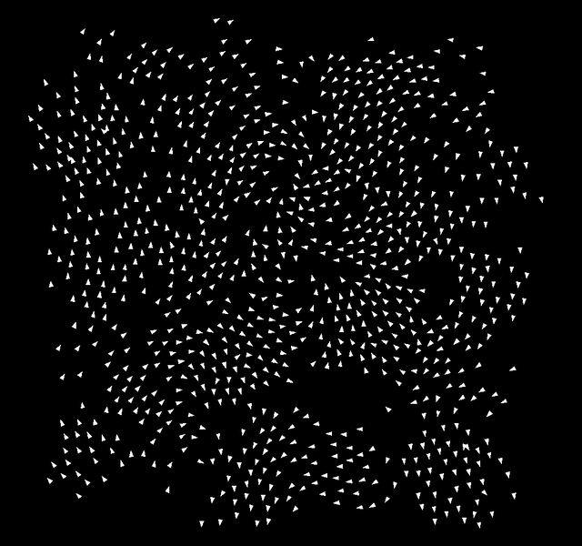
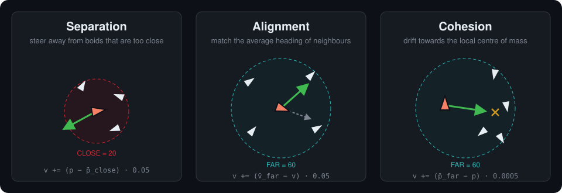
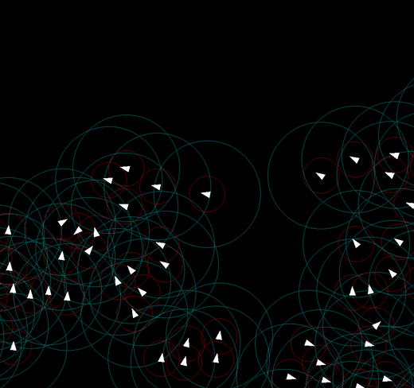
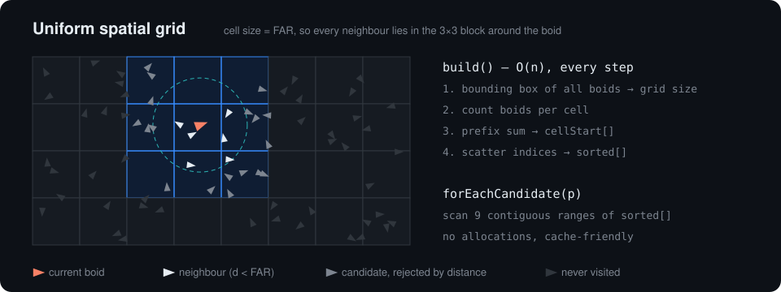
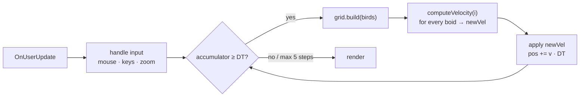
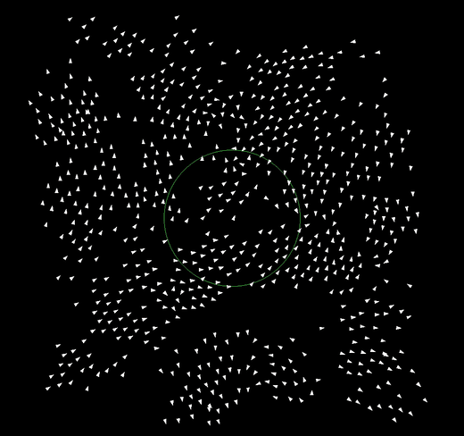
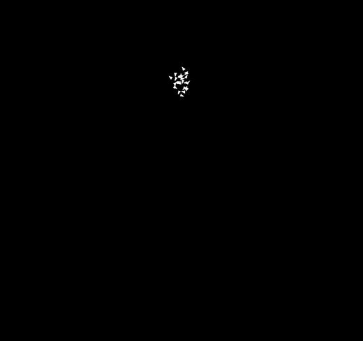

<div align="center">

# 🐦 Boids — Real-time Flocking Simulation

**An interactive C++23 implementation of Craig Reynolds' _boids_ model, with a uniform spatial grid that keeps neighbour search close to O(n).**




<sub>900 boids, recorded from the simulation. No scripted paths: the flocks come from three local rules.</sub>

</div>

---

## ✨ Highlights

- **Emergent behaviour from local rules.** Each boid only looks at its neighbours, yet the population forms flocks, splits and merges again.
- **Spatial hashing with a counting sort.** The grid is rebuilt every step in **O(n)** and neighbour lookups scan contiguous memory, so the cost doesn't grow as **O(n²)**.
- **Deterministic fixed-timestep loop.** The physics runs at 60 Hz with an accumulator and a cap on sub-steps, so a slow frame can't trigger a "spiral of death".
- **Order-independent updates.** All new velocities are computed into a separate buffer before any are applied, so the loop is data-parallel and runs across all cores with OpenMP.
- **Interactive camera and input.** Zoom is anchored at the cursor, the mouse attracts or repels boids with a distance falloff, and you can spawn boids by clicking.
- **Robotics-style world frame.** The world uses REP-103-style axes (x up, y left on screen), mapped to pixels by an affine `Frame` transform built on Eigen.

---

## 🧠 How it works

Every boid keeps a position and a velocity. On each step it applies three steering rules to the neighbours inside two radii:

<p align="center">
  
</p>

| Rule | Neighbourhood | Effect | Weight |
|------|---------------|--------|--------|
| **Separation** | `d < CLOSE` (20) | push away from the mean position of crowding boids | `0.05` |
| **Alignment** | `CLOSE ≤ d < FAR` (60) | steer towards the mean velocity of the flock | `0.05` |
| **Cohesion** | `CLOSE ≤ d < FAR` (60) | drift towards the local centre of mass | `0.0005` |

On top of the three rules, each boid is also subject to:

- **Soft boundaries.** A boid that leaves the `±450 × ±500` box is nudged back with a constant turn factor, so flocks curve around instead of bouncing off a wall.
- **Speed clamping.** Speed is kept within `[1, 100]` units/s, and a boid with zero velocity keeps its previous heading.
- **Mouse field.** Within a 150-unit radius the cursor attracts or repels boids with a linear falloff `1 − d/R`.

You can toggle the radii live with **`D`**:

<p align="center">
  
  <br><sub>Debug view: red circles are the separation radius, teal circles are the alignment and cohesion radius.</sub>
</p>

---

## ⚡ Performance: spatial grid

A naive implementation compares every pair of boids, which is **O(n²)** per frame. Here the world is divided into cells whose size equals the `FAR` radius, so every possible neighbour sits in the **3 × 3 block** of cells around the boid.

<p align="center">
  
</p>

The grid is stored as a flat structure, similar to CSR:

```cpp
// 1. count boids per cell          ++cellStart[c + 1]
// 2. exclusive prefix sum          cellStart[c + 1] += cellStart[c]
// 3. scatter indices by cell       sorted[cursor[cell]++] = i
//
// The boids of cell c are then  sorted[cellStart[c] .. cellStart[c + 1])
```

The buffers keep their capacity between frames, so the hot loop doesn't allocate after warm-up. The grid size adapts to the bounding box of the boids and is capped at 512 × 512 cells.

---

## 🔁 Simulation loop



---

## 🖱️ Interaction

<table>
<tr>
<td align="center" width="50%">
  <br>
  <sub><b>LMB</b> attracts (green), <b>RMB</b> repels (red)</sub>
</td>
<td align="center" width="50%">
  <br>
  <sub><b>MMB</b> spawns 20 boids. Separate groups find each other and merge.</sub>
</td>
</tr>
</table>

| Input | Action |
|-------|--------|
| <kbd>Left mouse</kbd> (hold) | Attract boids to the cursor |
| <kbd>Right mouse</kbd> (hold) | Repel boids from the cursor |
| <kbd>Middle mouse</kbd> | Spawn 20 boids at the cursor |
| <kbd>Scroll</kbd> | Zoom in/out, anchored at the cursor |
| <kbd>A</kbd> | Add 100 boids at random positions |
| <kbd>D</kbd> | Toggle the debug radii |
| <kbd>R</kbd> | Reset the world |
| <kbd>Z</kbd> | Reset the camera |
| <kbd>Space</kbd> | Pause or resume |

> The simulation starts with an **empty world**. Press <kbd>A</kbd> or click the middle mouse button to add boids.

---

## 🛠️ Build & run

**Requirements:** a C++23 compiler (GCC 13+ or Clang 17+), CMake ≥ 3.20, Eigen 3, and X11/OpenGL/libpng/ALSA development headers.

```bash
# Ubuntu / Debian
sudo apt install build-essential cmake ninja-build libeigen3-dev \
                 libx11-dev libgl1-mesa-dev libpng-dev libasound2-dev

git clone https://github.com/SelimMucharski/boids.git
cd boids
cmake -B build -G Ninja -DCMAKE_BUILD_TYPE=Release
cmake --build build
./build/main
```

> 💡 If CMake finds OpenMP, the velocity update runs on all cores automatically (`#pragma omp parallel for`). Without OpenMP the project still builds and runs on a single thread. Use `OMP_NUM_THREADS=N ./build/main` to limit the number of threads.

---

## ⚙️ Tuning

All parameters live in the `cfg` namespace at the top of [`main.cpp`](main.cpp) as `constexpr` values:

| Parameter | Default | Meaning |
|-----------|---------|---------|
| `CLOSE` / `FAR` | `20` / `60` | separation radius / alignment and cohesion radius |
| `AVOID_factor` | `0.05` | separation strength |
| `MATCHING_factor` | `0.05` | alignment strength |
| `CENTERING_factor` | `0.0005` | cohesion strength |
| `TURN_factor` | `0.2` | how strongly the boundaries push boids back |
| `MIN_SPEED` / `MAX_SPEED` | `1` / `100` | speed limits |
| `MOUSE_RADIUS` | `150` | range of the mouse attraction and repulsion |
| `ATTRACT_factor` / `REPEL_factor` | `2.0` / `4.0` | mouse field strength |
| `DT` | `1/60` | fixed physics timestep |

---

## 📁 Project structure

```
boids/
├── main.cpp                    # simulation, spatial grid, rendering, input
├── include/
│   └── olcPixelGameEngine.h    # single-header 2D engine (window, input, drawing)
├── docs/                       # README media
└── CMakeLists.txt
```

---

## 📚 References

- C. W. Reynolds, *Flocks, Herds, and Schools: A Distributed Behavioral Model*, SIGGRAPH '87.
- [olcPixelGameEngine](https://github.com/OneLoneCoder/olcPixelGameEngine) by OneLoneCoder.
- [Eigen](https://eigen.tuxfamily.org/), a C++ template library for linear algebra.
